 

 

## ⚛️ What I work on

My research looks at **reliability, verification, and benchmarking in noisy quantum computation** — the cases where a result passes one metric while the thing it was supposed to measure has already gone wrong. I combine analytic derivation, numerical simulation, regression tests, and preregistration so that every claim can be checked end to end.

## 🧭 Research arc

  

## 🔬 Projects

  <a href="https://github.com/Raina-ya/bias-probe-visibility/blob/main/paper/main_v4.pdf"><b>📄 Paper</b></a> ·
  <a href="https://github.com/Raina-ya/bias-probe-visibility/tree/main/docs/results"><b>📊 Results</b></a> ·
  <a href="https://doi.org/10.5281/zenodo.24362003"><b>🏷️ v1.1 DOI</b></a>

  <a href="https://github.com/Raina-ya/adaptive-qem-benchmark/blob/main/slides/qem_project_slides.pdf"><b>🎞️ Slides</b></a> ·
  <a href="https://github.com/Raina-ya/adaptive-qem-benchmark/blob/main/docs/hardware_readiness_review.md"><b>🛑 Hardware review</b></a> ·
  <a href="https://github.com/Raina-ya/adaptive-qem-benchmark/blob/main/results/processed/final_evidence_matrix_v1.csv"><b>🧾 Evidence matrix</b></a>

  <a href="https://github.com/Raina-ya/sense-correct-abstain/blob/main/docs/research_program_plan_v0.md"><b>🗺️ Research plan</b></a> ·
  <a href="https://github.com/Raina-ya/sense-correct-abstain/blob/main/docs/freeze/gate1_design_lock.md"><b>🔒 Gate 1 lock</b></a>

## 🗓️ Recent milestones

| Date | Milestone |
| :--- | :--- |
| **2026-11-20** | `sense-correct-abstain` — Gate 1 mathematical spec and design lock frozen (M3) |
| **2026-11-19** | `bias-probe-visibility` — paper v4.2: related-work section with 80 verified citations |
| **2026-11-19** | `bias-probe-visibility` — v1.1 released with a first hardware addendum on `ibm_marrakesh`; registered prediction held |
| **2026-11** | `bias-probe-visibility` — v1.0 released with Zenodo DOI; confirmatory holdout read once |
| **2026-11** | `adaptive-qem-benchmark` — selector audit and hardware readiness review concluded as documented no-gos |

## 🧰 Toolkit

  
  
  
  
  
  
  
  
  
  
  

## 📐 Research standards

> **Hypotheses first** — questions, predictions, and stopping rules are frozen before an experiment runs. 
> **Fully regenerable** — every figure, table, and paper number is rebuilt from committed code and results. 
> **Negative results stay** — no-go reviews and methods that lost are kept on the record. 
> **Honest labeling** — results are classical or noisy simulation unless explicitly marked as hardware.

 

<picture>
  <source media="(prefers-color-scheme: dark)" srcset="https://raw.githubusercontent.com/Raina-ya/Raina-ya/output/snake-dark.svg" />
  <source media="(prefers-color-scheme: light)" srcset="https://raw.githubusercontent.com/Raina-ya/Raina-ya/output/snake.svg" />
  
</picture>

⟨ψ| measured, not assumed |ψ⟩

